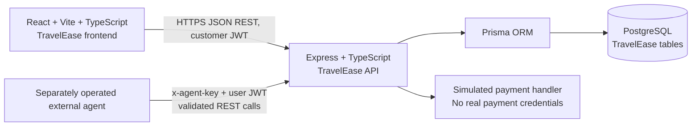

# Application architecture

Frontend and backend run independently. The frontend owns presentation and user input; the API validates requests and enforces identity, confirmation, idempotency and ownership; PostgreSQL stores booking records. The external agent is a future API client and is not embedded in this repository.
